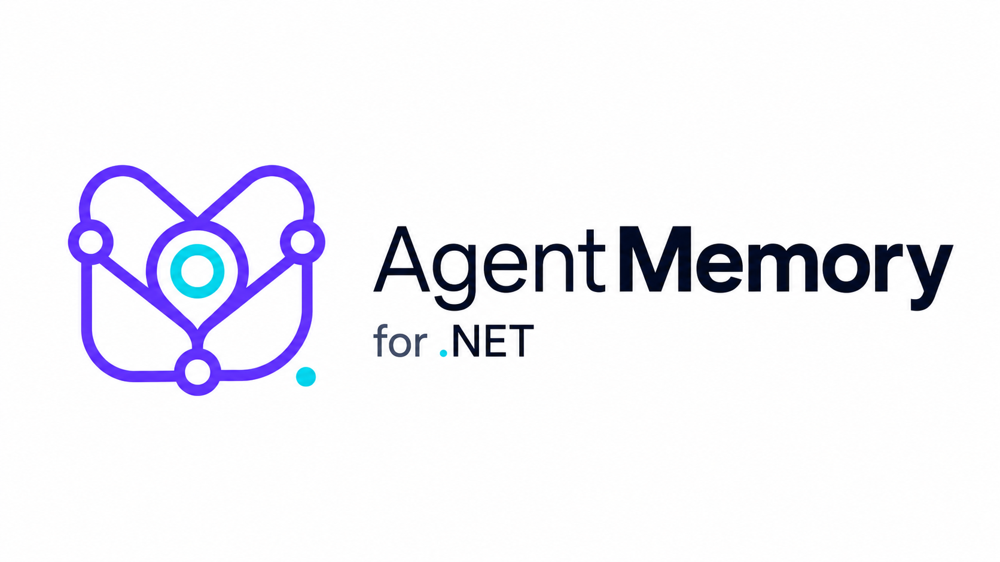

# Agent Memory for .NET



> *A native .NET reimplementation of graph-native agent memory, inspired by Neo4j Agent Memory and
> verified against its compatibility kit.*

> Independent community project. Not affiliated with, endorsed by, or supported by Neo4j, Inc.
> Not related to the similarly named `agentmemory` package on npm.

Give your .NET agents a memory that actually lasts. Agent Memory for .NET is a persistent,
**graph-native** memory engine for AI agents, backed by Neo4j — so what your agent learns in one
conversation is still there, structured and queryable, in the next one. Built for the Microsoft Agent
Framework, Semantic Kernel, direct .NET usage, and MCP clients.

## Project Status

This is an early-stage, actively-developed open-source project, not a mature commercial product with an
SLA or support contract. It's maintained by its author on a best-effort basis. Expect rough edges: bugs
and edge cases are likely to surface as real-world usage broadens, especially just after a release.

Issues are genuinely welcome — please
[open one](https://github.com/joslat/agent-memory-dotnet/issues/new) for bugs, gaps, or unexpected
behavior. They get triaged and fixed as they're found, not ignored, but turnaround depends on available
time, not a guaranteed response window. Review the
[Threat Model](https://github.com/joslat/agent-memory-dotnet/blob/main/docs/security/threat-model.md) and
[Production Checklist](https://github.com/joslat/agent-memory-dotnet/blob/main/docs/security/production-checklist.md)
before production use, pin versions deliberately, and check the
[CHANGELOG](https://github.com/joslat/agent-memory-dotnet/blob/main/CHANGELOG.md) between upgrades. As
with any permissively licensed software, it is provided as is, without warranty (see [Licensing](#licensing)).

## Why Agent Memory for .NET

- **Memory that survives the session.** Conversations, facts, preferences, and relationships persist as
  a real knowledge graph, not a scratchpad that evaporates when the process exits.
- **Three memory layers, not one.** Short-term conversation history, long-term facts/preferences/entities,
  and reasoning traces (steps, tool calls, prior executions) are all first-class citizens.
- **Graph-native, not just vectors.** Vector, fulltext, hybrid, and graph-traversal retrieval, plus
  optional GraphRAG context — because "similar text" and "connected knowledge" are different questions.
- **Multi-tenant capable.** Owner and store isolation are enforced throughout scoped repository,
  recall, GraphRAG, reasoning, maintenance, and agent-tool operations.
  Multi-tenant hosts must establish an owner scope for every agent run. Unscoped operations retain
  global behavior for administrative and single-tenant scenarios.
  **One deliberate exception, stated precisely:** short-term messages are addressed *by handle*.
  `:Message` nodes carry no `owner_id`, and reading a session's messages by session id performs no
  owner check — **a session id is itself the capability.** Long-term memory, recall, and session
  *clearing* are all owner-scoped; short-term reads by handle are not. Treat session ids as secrets,
  and reach short-term history through recall when you want owner enforcement.
- **Time-aware.** Bitemporal recall and non-destructive decay mean memory can answer "what did we believe
  back then" as well as "what do we believe now."
- **Drops into the ecosystem you already use.** First-class adapters for the Microsoft Agent Framework,
  Semantic Kernel, and MCP, plus a direct .NET API for everything else.
- **Fits the .NET you already run.** Multi-targets net8.0, net9.0, and net10.0, so adopting it doesn't
  mean adopting a new runtime first.
- **Faithful to its roots.** Verified against the upstream Python `neo4j-labs/agent-memory` project's own
  compatibility kit, so the .NET reimplementation isn't just inspired by the original — it's checked
  against it.

## Memory Governance

Any memory system that spans tenants, sessions, and time needs to answer these questions structurally —
not by convention. AgentMemory does:

| Question | How it's answered |
|---|---|
| **Who owns a memory?** | Every long-term record carries an `owner_id`/`MemoryScope`; `null` means shared/global — ownership is never ambiguous. |
| **Where did it come from?** | `source_message_ids` plus `EXTRACTED_FROM`/`EXTRACTED_BY` graph edges trace every fact, entity, and preference back to the message and extractor that produced it. |
| **What changed, and when?** | A bitemporal model separates valid-time (`valid_from`/`valid_until`) from transaction-time (`created_at`/`invalidated_at`); contradictions resolve via non-destructive `SUPERSEDED_BY` — **opt-in** (`ExtractionOptions.SupersedeReplacedFacts`) and only for relations the vocabulary declares **single-valued**, since replacing a multi-valued fact would silently drop a true one; point-in-time recall answers "what did we believe back then" either way. |
| **Why was it recalled?** | Every long-term read is logged to a read/access audit trail (who, what, when, how often); ranking is driven by explicit, configurable recency/structural signals — not an opaque score. |
| **How is it invalidated or deleted?** | Long-term memory soft-invalidates by default (kept, recoverable); hard deletion is opt-in. Short-term session data can be cleared explicitly, always scoped to a single owner. |
| **Can scoped tenants see one another's memory?** | No. Owner-scoped operations return only that owner's memory and, when enabled, shared memory. Unscoped reads are global in the default compatibility mode, so multi-tenant hosts must establish an owner scope for every operation. **Short-term messages are the one by-handle exception:** they carry no `owner_id`, so anyone holding a session id can read that session's messages. Session ids are capabilities — keep them secret. |
| **How do applications meet retention and privacy requirements?** | Scoped decay/pruning, non-destructive-by-default invalidation, the read-audit trail, and physical per-application isolation are the building blocks — wire them into whatever retention or privacy policy your application needs. |

## Quick Start

```bash
dotnet add package AgentMemory
```

```csharp
using AgentMemory;
using AgentMemory.Abstractions.Services;
using AgentMemory.Neo4j.Infrastructure;
using Microsoft.Extensions.DependencyInjection;

var services = new ServiceCollection();

services.AddNeo4jAgentMemory(
    memory => { },
    neo4j =>
    {
        neo4j.Uri = "bolt://localhost:7687";
        neo4j.Username = "neo4j";
        neo4j.Password = "password";
    },
    configureLlm: null);

var provider = services.BuildServiceProvider();

var bootstrapper = provider.GetRequiredService<ISchemaBootstrapper>();
await bootstrapper.BootstrapAsync();

var memory = provider.GetRequiredService<IMemoryService>();
await memory.AddMessageAsync("session-01", "conversation-01", "user", "I prefer dark mode.");
```

For production semantic search, register a real `IEmbeddingGenerator<string, Embedding<float>>` from
`Microsoft.Extensions.AI`; the core stubs are safe defaults, not production embeddings.

## Documentation

Full documentation lives in [docs/](https://github.com/joslat/agent-memory-dotnet/tree/main/docs) — start with Getting Started:

- [Getting Started](https://github.com/joslat/agent-memory-dotnet/blob/main/docs/getting-started.md)
- [Architecture](https://github.com/joslat/agent-memory-dotnet/blob/main/docs/architecture.md)
- [The Memory Map](https://github.com/joslat/agent-memory-dotnet/blob/main/docs/memory-map.md) - what this memory layer does, does partially, and does not do, with each claim labelled built / wired / measured
- [Agent Framework Integration](https://github.com/joslat/agent-memory-dotnet/blob/main/docs/agent-framework.md)
- [Schema Reference](https://github.com/joslat/agent-memory-dotnet/blob/main/docs/schema.md)
- [Schema Extensions](https://github.com/joslat/agent-memory-dotnet/blob/main/docs/extensions/README.md) - optional, additive-only schema modules a capability can bring with it; none is active by default, and each one's DDL is applied by an operator, not by application startup
- [Specification](https://github.com/joslat/agent-memory-dotnet/blob/main/docs/specification.md)
- [Neo4j Memory Ecosystem](https://github.com/joslat/agent-memory-dotnet/blob/main/docs/neo4j-memory-ecosystem.md) - schema-parity/TCK compatibility tooling and the review process behind releases
- [Threat Model](https://github.com/joslat/agent-memory-dotnet/blob/main/docs/security/threat-model.md) - what isolation/authorization properties hold today, what's a documented gap, and who owns closing it
- [Production Checklist](https://github.com/joslat/agent-memory-dotnet/blob/main/docs/security/production-checklist.md) - what a deployment must configure itself (AgentMemory can't guarantee these alone)

See [SECURITY.md](https://github.com/joslat/agent-memory-dotnet/blob/main/SECURITY.md) to report a vulnerability.

## Relationship to Upstream

This project is inspired by [`neo4j-labs/agent-memory`](https://github.com/neo4j-labs/agent-memory) — the
Python reference implementation — and preserves compatible graph concepts from its
[schema](https://github.com/joslat/agent-memory-dotnet/blob/main/docs/schema.md) where useful. But it's a
**from-scratch .NET reimplementation, not a port**: it shares no code with the Python project. Most of
what it needs — the Neo4j driver integration, extraction pipeline, embeddings, DI wiring, and the
Microsoft Agent Framework/Semantic Kernel/MCP adapters — has no ready-made equivalent in the .NET
ecosystem to lean on, so it was built natively rather than bound or ported. It is not an official Neo4j
repository or product; schema and behavioral compatibility with the original are verified explicitly (see
[Neo4j Memory Ecosystem](https://github.com/joslat/agent-memory-dotnet/blob/main/docs/neo4j-memory-ecosystem.md)).

## Related projects

- [GraphBridge](https://github.com/joslat/GraphBridge.EFCore): an Entity Framework Core provider for Neo4j, from the same author, with an experimental GraphRAG toolkit for .NET. Its answers show the stored text each quote came from, or say why they can't answer, and its graphs can be shared with neo4j-graphrag.

## Contributing

See [CONTRIBUTING.md](https://github.com/joslat/agent-memory-dotnet/blob/main/CONTRIBUTING.md) for build, test, and contribution guidance.

## Licensing

Three licences live in this repository from version 2.0.0: two for code, project by project, and one for the specification.

| Licence | What |
|---|---|
| **Apache-2.0** | `src/AgentMemory.Extensibility` (the module SDK; its 0.x releases were MIT; Apache-2.0 from the release that ships with 2.0.0, which adds the declared traversal and the trial gate), `src/AgentMemory.Extensibility.Ampack`, `src/AgentMemory.Extensibility.Neo4j`, `src/AgentMemory.Extensibility.AgentFramework`, every `src/AgentMemory.Packs.*` library, `tools/Ampack`, `reader-rs`, `conformance/pack-v1.1` |
| **MIT** | Everything else: `AgentMemory.Core`, `AgentMemory.Abstractions`, `AgentMemory.Neo4j`, the Agent Framework, Semantic Kernel and MCP adapters, the samples, the benchmarks, the remaining tools, and the sample knowledge pack under `packs/` |
| **CC BY 4.0** | The specification texts and data files in `spec/` (see `spec/LICENSE.md`) |

Why two code licences: the Apache-2.0 projects implement the ampack format and its host procedure, on which the author has filed a patent application. Apache-2.0 section 3 gives every user of that code an express patent licence; MIT has no express patent clause. The core library stays MIT as it has been since its first release. Each Apache-2.0 project carries its own `LICENSE` and `NOTICE`, its source files carry an SPDX header, and its package declares `Apache-2.0`. Implementations of the specification that do not use this code are covered by the patent pledge in [PATENTS.md](https://github.com/joslat/agent-memory-dotnet/blob/main/PATENTS.md): royalty-free for conforming implementations, with the conditions stated there. The root [LICENSE](https://github.com/joslat/agent-memory-dotnet/blob/main/LICENSE) file is the MIT licence that applies where no project-level licence says otherwise.
