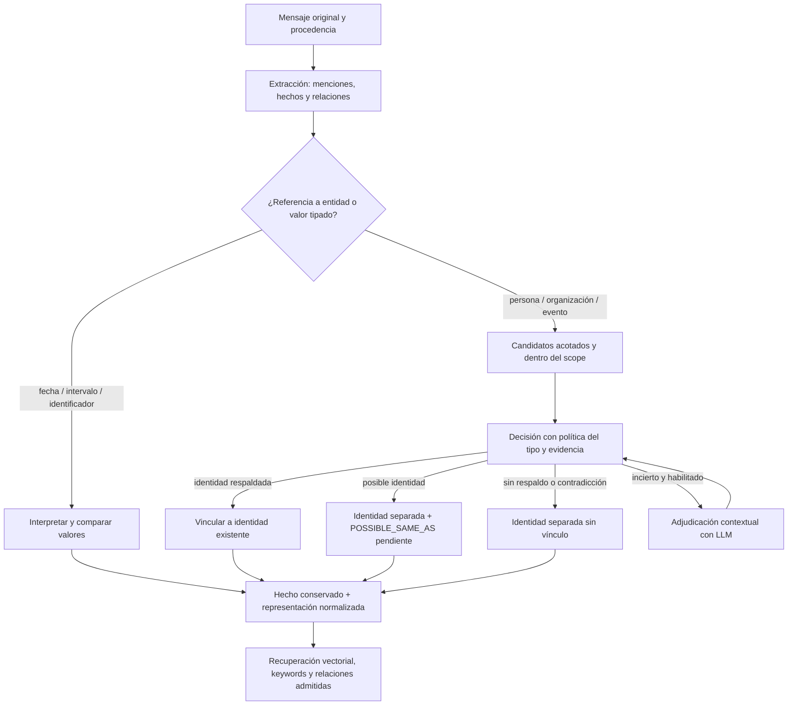

# Evidence-based identity

> **Diseño de implementación para AgentMemory.** Propuesta autorizada por el propietario; implementación y aceptación se registran por separado. Los nombres de API de este documento son propuestas hasta que compilen y sus pruebas pasen. No supone una nueva medición de precisión.

## La decisión

Una memoria guarda lo que se dijo y la evidencia que lo respalda. La identidad de aquello de lo que habla es una interpretación que puede mejorar o corregirse. Una interpretación no puede sustituir silenciosamente una fecha, un importe, un identificador o la afirmación original.

La búsqueda aproximada permanece: encuentra candidatos. La decisión de identidad se toma después, con reglas del dominio, valores tipados, atributos, contexto y contradicciones. Un resultado incierto conserva una identidad separada.

**Regla de seguridad:** una contradicción explícita no se compensa acumulando similitud. Una puntuación de cadenas no es una probabilidad de identidad.



El fallback del LLM tiene un solo paso, no un bucle: sólo se consulta una vez por decisión elegible. El dibujo muestra que su respuesta vuelve a pasar por la política, no que pueda volver a dispararse indefinidamente.

## Qué reutilizamos

| Existe hoy | Cómo se usa |
|---|---|
| Mensajes originales y EXTRACTED_FROM | Evidencia de lo observado y contexto de la mención |
| Fact, Entity y ABOUT | Hechos y entidades siguen siendo registros distintos |
| OccurredOn, ValidFrom, ValidUntil y precisiones | Representación temporal; no se añade otro sistema de fechas |
| Exact, fuzzy, partial y semantic matchers | Señales de candidatos; se retira su autoridad automática en el modo nuevo |
| SAME_AS y DuplicateStatus legados | Referencia de compatibilidad y revisión; los pendientes nuevos usan una representación distinta de la equivalencia confirmada |
| Transacciones de PersistenceStage | Escritura de entidad, decisión y vínculos dentro del mismo límite de persistencia |
| IChatClient | Adaptador opcional de adjudicación; Core no incorpora un cliente ni una dependencia de proveedor |
| Scope del propietario y datos compartidos | Una ontología no concede acceso a datos fuera del scope |
| Búsqueda vectorial, full-text y ensamblado de contexto | Se mantienen; ninguna puntuación de recuperación decide identidad |

No se añaden dependencias de Graphiti, Mem0, Letta o Neo4j Agent Memory. Se adoptan separaciones de responsabilidades, no sus implementaciones.

### Huecos concretos que hay que cerrar

La clasificación POLE+O actual no distingue referencias de valores: una fecha puede llegar como OBJECT. No basta con añadir un tipo DATE al prompt y confiar en él. Hace falta el discriminante de valor en Core y una representación que permita conservar fechas incompletas.

El método AddSameAsRelationshipAsync existe en Neo4jEntityRepository, pero no forma parte del contrato IEntityRepository. Core necesita un contrato de persistencia de decisiones/pending explícito, compatible con backends externos. Un backend sin esa capacidad debe rechazar el modo solicitado en configuración; no se debe descartar el pending silenciosamente ni introducir una dependencia de Core a Neo4j.

El lector legado EntityQueries.GetSameAsEntities recorre SAME_AS sin filtrar status y no devuelve ese estado. Esto obliga a aislar las hipótesis nuevas en una relación o registro distinto; no basta con confiar en que todos los lectores futuros recuerden un filtro. El nuevo modo no escribirá sus pendientes como SAME_AS. Este hallazgo no demuestra por sí solo una respuesta incorrecta en los consumidores actuales.

El recorrido actual precarga entidades por tipo y el resultado del resolver sólo entrega una Entity. El diseño necesita consultas de candidatos acotadas y un resultado adicional con estado y evidencia. Estas son entregas reales, no detalles que ya estén implementados por reutilizar los nombres existentes.

## 1. Observaciones, valores e identidades

### La observación se conserva

Un hecho mantiene sujeto, predicado, objeto extraídos, mensajes fuente y citas/offsets cuando existan. El nombre de presentación de una entidad y la vinculación a su ID son información separada. La proyección puede mostrar un nombre confirmado más completo sin cambiar el objeto literal almacenado ni hacer pasar una hipótesis por el original.

La normalización no autoriza a inventar información. Si el modelo extrajo un dato equivocado, conservarlo no lo valida: sigue siendo una afirmación extraída con su nivel de confianza y su procedencia. Las comprobaciones de fuente y las contradicciones son requisitos distintos de la igualdad de valores.

### Valores tipados

Un valor no se envía al resolver de nombres. La representación distingue:

- fecha de calendario, con precisión y componentes conocidos;
- instante, con offset/zona explícitos cuando correspondan;
- intervalo y sus extremos;
- identificador y su espacio de nombres;
- cantidades con unidad, en una entrega posterior.

El primer incremento cubre fechas y la prevención de cambios en valores. No promete un parser universal de idiomas, zonas horarias, calendarios o unidades.

**No se crea un año a partir del reloj de la máquina.** Una fecha relativa sólo se resuelve con la referencia temporal del mensaje y una regla soportada; se registra que fue interpretada. Si falta contexto, el resultado permanece incompleto.

| Comparación | Resultado |
|---|---|
| 12 December 2026 / 2026-12-12 | Equivalente |
| 12 December 2026 / 3 December 2026 | Distinto |
| December 12 sin año / 2026-12-12 | Indeterminado salvo referencia temporal suficiente |
| December 2026 / 2026-12-12 | Compatible en período, no igualdad |
| 9–13 December / 12 December | Contiene; no igualdad |
| 2026-12-12, sin hora / 2026-12-12T00:00Z | No afirmar igualdad de instante |

La identificación combina el tipo declarado con interpretación determinista del valor completo. No busca una fecha dentro de cualquier nombre: una persona llamada “May” o un producto “December 12 Edition” no se convierte automáticamente en una fecha.

### Entidades

Una mención como “Acme”, “Lucía” o “el cutover” puede referirse a una entidad conocida. Su ID no se deduce de la semejanza del nombre. Tampoco basta un nombre exacto si hay varias personas llamadas igual.

La boda y la capacitación permanecen como eventos separados aunque ocurriesen el mismo día. Una clave temporal identifica un valor de fecha, no un evento.

## 2. Una ontología pequeña y operativa

La ontología configura qué significa identidad en cada tipo. Se introduce como una política acotada en las opciones de resolución, sin un framework OWL ni otra autoridad de esquema.

| Parte de la política | Ejemplo | Autoridad |
|---|---|---|
| Tipo y tipos compatibles | PERSON, EVENT, ORGANIZATION | Define qué comparaciones son admisibles |
| Claves de identidad | employee_id dentro de company_id | Igualdad exacta de una clave completa y confiable |
| Atributos de contradicción | identificador distinto en el mismo namespace | Veto; no se compensa con scores |
| Alias confirmados | alias respaldado por fuente o decisión registrada | Evidencia, con procedencia; no una lista ciega de sinónimos |
| Atributos de contexto | organización, participantes, lugar, referencia a evento | Evidencia adicional, no identidad por sí solos |
| Umbral de revisión | por tipo y por señal | Decide qué candidatos merece la pena revisar |
| Política de confirmación | claves exactas, alias confirmado, adjudicación contextual habilitada | Establece quién puede confirmar y con qué evidencia |
| Límites | candidatos, bytes de contexto, llamadas, timeout | Control explícito de coste y recursos |

Una clave sólo es confiable si su origen lo es. El identificador inventado por un LLM no adquiere autoridad al aparecer en Attributes. La clave lleva namespace, procedencia y ámbito. Una clave parcial no confirma identidad; dos candidatos con la misma clave constituyen una ambigüedad de datos que se conserva y se informa.

Las fechas de un evento pueden cambiar por una corrección legítima: no son siempre una clave inmutable del evento. La política distingue identidad, estado temporal y evidencia contradictoria. Una diferencia de fecha bloquea unir dos valores DATE; en un EVENT puede requerir una decisión de cambio explícita en vez de declarar dos entidades distintas automáticamente.

## 3. Candidatos antes de decisiones

El generador combina coincidencias exactas, alias, fuzzy y búsqueda vectorial. Cada señal se conserva por separado. No se mezclan sus números como si fuesen probabilidades intercambiables.

Los candidatos se deduplican por ID y se ordenan de forma determinista. Hay límites antes de cargar contexto para el LLM. La consulta mantiene propietario, aplicación/tenant cuando corresponda y permisos. El nuevo recorrido no debe heredar una lectura ilimitada de todas las entidades del tipo.

Las claves configuradas necesitan una ruta de búsqueda exacta soportada por el backend o por un proveedor del host. Configurar una clave no implica que el almacén ya tenga un índice sobre un JSON arbitrario. La implementación debe declarar qué búsquedas soporta y fallar en configuración si se solicita una garantía que no puede cumplir.

El DTO de extracción LLM actual tampoco expone Attributes. Las claves confiables deben llegar desde el host o desde una integración estructurada con procedencia; ampliar el DTO sería una entrega adicional. Añadir un campo al prompt no convierte una clave generada por el modelo en una clave verificada. En el ejemplo de configuración, la lista de propiedades define una clave compuesta: deben estar presentes todos sus componentes.

## 4. Tres decisiones, con evidencia

| Decisión | Entidad de destino | Efecto |
|---|---|---|
| Confirmada | Existente | Se registra la decisión y se vinculan observaciones; no se reescriben valores originales |
| Pendiente | Nueva y separada | POSSIBLE_SAME_AS hacia candidatos admisibles; no hereda sus hechos como identidad confirmada |
| Nueva | Nueva y separada | Sin SAME_AS cuando no hay candidato admisible o existe contradicción |

Una coincidencia exacta de nombre es una señal. El dominio puede declarar un nombre único dentro de un namespace concreto, pero no se presupone globalmente.

POSSIBLE_SAME_AS es el nombre propuesto para el vínculo candidato del modo nuevo. Nunca se interpreta como igualdad, tampoco después de revisar la propuesta: la confirmación registra y aplica los vínculos de identidad autorizados por esa decisión. La forma exacta y su propiedad de esquema deben aprobarse en IDER-03. No se modifica ni reclasifica automáticamente el SAME_AS legado.

Una sugerencia rechazada no reaparece silenciosamente en la siguiente ingestión con la misma evidencia. Confirmaciones y rechazos tienen revisión, motivo, fuente y versión de política. POSSIBLE_SAME_AS pending no participa como igualdad, no es transitivo y no autoriza fusiones físicas.

En el modo nuevo, el resultado público actual que sólo entrega una Entity se mantiene por compatibilidad; un contrato adicional lleva la decisión. El resultado detallado alimenta persistencia y observabilidad. Las implementaciones externas existentes de IEntityResolver no se reclasifican automáticamente como verificadores de identidad.

## 5. Fallback contextual con LLM

Se activa explícitamente y sólo para candidatos sin confirmación ni veto. Sin LLM, el sistema puede crear o dejar pendiente: guardar memoria no depende de una API externa.

La solicitud contiene la mención, mensajes/fragmentos fuente acotados, tipos, atributos admitidos y candidatos por ID. No contiene secretos ni datos de otro scope. El texto del usuario y los documentos son datos no confiables, no instrucciones para la política.

El modelo devuelve una decisión estructurada sobre IDs ofrecidos, razones y citas de apoyo. Se rechazan IDs inventados, JSON inválido, scores no finitos/fuera de rango y citas que no se encuentran en las fuentes suministradas. Encontrar una cita no prueba por sí solo la conclusión semántica.

La política del tipo decide si una respuesta contextual puede confirmar o sólo proponer revisión. Un LLM nunca puede vencer una incompatibilidad de valores ni un veto del host. Sus scores son valoraciones del modelo, no probabilidades calibradas.

Una llamada como máximo por decisión elegible; límite por ingestión, bytes, tokens solicitados, timeout y cancelación. Una respuesta que llega después del timeout no puede persistir cambios. El fallo conserva la mención y una decisión pendiente/nueva; no elimina el hecho.

## 6. Persistencia, revisión y reversibilidad

Se reutilizan mensajes y hechos como evidencia. Las decisiones de identidad se versionan con ID, mención/fuentes, destino propuesto, estado, motivos, política y evidencia. La propiedad de estos registros pertenece a una extensión de esquema explícita, con migración y conformance; no se escribe un JSON de control escondido en propiedades sin dueño.

Crear una entidad pendiente y su vínculo se realiza dentro de la transacción de persistencia. No se mantiene una transacción abierta mientras se espera a un modelo.

Confirmar o rechazar una decisión cambia su estado y los enlaces de esa decisión, no el texto histórico. Revocar una confirmación exige identificar sus enlaces y posteriores dependencias. No se anuncia undo completo hasta probar confirmación, nuevas escrituras, revocación, reinicio y concurrencia. No se reutiliza MergeEntitiesAsync como sustituto de una vinculación reversible.

Los datos antiguos se revisan con un informe de sólo lectura: objeto actual frente a object_surface, fechas estructuradas, alias sospechosos y procedencia disponible. Si falta evidencia, no hay reparación automática. No se fusiona ni se borra nada durante un upgrade.

## 7. Cómo lo usaría una aplicación

### Configuración propuesta

```csharp
// Boceto de API: no es aún una receta de la versión publicada.
options.Extraction.EntityResolution.Identity = new IdentityResolutionOptions
{
    Enabled = true,
    MaxCandidates = 12,
    MaxContextUtf8Bytes = 8_192,
    Policies = new Dictionary<string, EntityIdentityPolicy>
    {
        ["PERSON"] = new()
        {
            IdentityProperties = ["company_id", "employee_id"],
            AllowContextualConfirmation = false
        },
        ["EVENT"] = new()
        {
            IdentityProperties = ["calendar_namespace", "calendar_event_id"],
            AllowContextualConfirmation = false
        }
    }
};
```

Con claves confiables, la aplicación obtiene confirmaciones deterministas. Sin claves, conserva candidatos pendientes y puede habilitar un adjudicador contextual. Una persona puede revisar los pendientes; no se exige hacerlo para cada hecho guardado. Las observaciones no se pierden mientras esperan.

El usuario de la aplicación ve “identidad confirmada”, “posible coincidencia” o “entidad separada”. El historial explica por qué una mención se vinculó a otra. No se muestra al usuario una equivalencia inferida como si hubiera sido una afirmación suya.

### El caso Bruna

1. Se guardan la boda del 12, la capacitación del 3, el go-live del 11 y el viaje 9–13 con sus fuentes.
2. El 12 y el 3 son valores distintos, aunque las cadenas puntúen 86.
3. “Go-live” y “cutover” pueden proponerse como el mismo evento a partir del contexto; se registra qué evidencia une ambas menciones.
4. La recuperación temporal selecciona la semana. Una expansión acotada del evento confirmado trae el lugar y la presencia obligatoria, aunque ese detalle no tenga fecha propia.
5. La respuesta cuenta con fechas y lugares para detectar la incompatibilidad. El modelo de respuesta sigue necesitando razonar correctamente.

La expansión de eventos es una fase separada: no se considera implementada por tener un resolver de identidad nuevo. Un vínculo pending no autoriza a incorporar contexto como si perteneciera al evento confirmado.

## 8. Compatibilidad y despliegue

El nuevo modo comienza opt-in para respetar la compatibilidad de API, consultas, prompts y costes. El modo desactivado no añade consultas ni llamadas de modelo. La protección contra sustituciones de fechas distintas se trata como corrección de integridad, con pruebas específicas y notas de cambio; no se introduce una nueva política general silenciosamente.

No se activa en Recommended ni cambia el fallback de presets hasta pasar la aceptación y registrar la decisión de rollout. Conversational y el writer atraviesan el mismo punto de protección en Core. Esto no cambia quién extrae ni convierte DatesFromText en un verificador de identidad.

Modo shadow opcional: calcular decisiones sin cambiar persistencia, con límites y consentimiento de llamadas LLM. Compara decisiones frente al recorrido actual; nunca guarda hipótesis shadow como memoria.

## 9. Entregas y puertas de aceptación

| Fase | Alcance | Aceptación necesaria |
|---|---|---|
| IDER-00 | Diseño y contrato de calidad | Revisión contra código, límites y dependencias identificadas; no cuenta como feature |
| IDER-01 | Integridad temporal | Regresión roja antes del arreglo; 3/4/12 separados, representaciones equivalentes, años/precisión/intervalos y todas las rutas de matching |
| IDER-02 | Candidatos y decisión por política | Señales separadas, claves confiables, conflictos, ambigüedad, orden estable, límites y scopes; legacy off sin coste |
| IDER-03 | Persistencia pendiente y evidencia | Neo4j real: entidad separada + POSSIBLE_SAME_AS pending atómicos; rollback y reinicio; texto original y links correctos |
| IDER-04 | Adjudicador contextual opcional | Mocks y errores; timeout/cancelación, citas/IDs inválidos, veto no eludible; smoke real con presupuesto explícito |
| IDER-05 | Revisión y revocación | Confirmar/rechazar/revocar con escrituras posteriores, aislamiento y concurrencia; sin pérdida de evidencia |
| IDER-06 | Evento y recuperación completa | Fecha, lugar y obligación presencial en Q3; límites, pending no tratado como identidad, aislamiento; replays y paquetes |
| IDER-07 | Evaluación y rollout | Corpus revisado, variantes adversarias, costes y regresiones; decidir defaults con evidencia |

La petición del propietario autoriza este trabajo nuevo. No reanuda por sí sola el resto del antiguo goal pausado ni autoriza publicación, workflows completos o gasto de modelos sin presupuesto. Las fases se ejecutan en orden; se registran por separado diseño, código, pruebas offline y aceptación live.

## 10. Qué precisión esperamos mejorar y cómo demostrarlo

No hay un porcentaje defendible antes de medir. La hipótesis es reducir falsas uniones y corrupción posterior de hechos, a costa de más identidades pendientes y posibles duplicados temporales.

| Métrica | Qué detecta |
|---|---|
| Precisión de identidad | Uniones correctas / uniones realizadas; separada por tipo y evidencia |
| Recall de identidad | Identidades verdaderas enlazadas / identidades verdaderas revisadas |
| Corrupción de valores | Valores que cambian de significado entre extracción y persistencia |
| Pendientes y duplicación | Coste de ser conservador; cuánto requiere revisión |
| Evidencia completa por pregunta | Fecha, lugar, participantes y restricciones necesarias, no sólo palabras presentes |
| Exactitud de respuesta | Medición aparte de recuperación, con revisión explícita |
| Recursos | Consultas, llamadas LLM, tokens, p50/p95 y memoria |

El conjunto incluye Bruna original y busy, cambios de orden, 3/4/12, misma fecha expresada de otra manera, fecha incompleta, dos personas con el mismo nombre, hermano con apellido compartido, organizaciones parecidas, claves contradictorias y otro propietario con nombres idénticos. Las etiquetas de identidad deben revisarse independientemente; el modelo que decide no puede ser su único juez.

Una subida de precisión con una caída grande de recall no se presenta como victoria global. La aceptación exige preservar los casos legítimos de alias y continuidad, además de impedir el falso merge de fechas. El caso de Pablito es una reproducción necesaria, no un benchmark general.

## 11. Ajustes tras comparar otros sistemas

La [revisión de proveedores](evidence-based-identity-provider-review.md) separa código inspeccionado, comportamiento documentado y propuestas propias. Supermemory aporta patrones de evolución y revisión; su servidor no es código público. Graphiti, Neo4j Agent Memory, Hindsight, Cognee, Mem0 OSS y Honcho ofrecen implementaciones abiertas con licencias y alcances diferentes. No se han ejecutado contra Bruna.

Se incorporan estas precisiones al diseño:

1. **Contexto independiente.** El embedding del nombre y su fuzzy son dos mediciones de la misma señal, no dos pruebas independientes. Repetir la frase en un resumen tampoco añade una fuente. Se conservan orígenes y se evita contar derivados de una misma fuente como corroboración independiente.
2. **Vecinos selectivos.** Compartir un vecino muy común, como user, aporta poco contexto discriminante. La selectividad puede ordenar candidatos y revisión; no autoriza identidad por sí sola. Se evalúa con un caso de dos personas distintas que comparten organización y conversación.
3. **Autoridad del host.** Las referencias con ID, namespace y tipo verificados por la aplicación tienen un recorrido determinista. Una corrección explícita marcada por el host no se vuelve a aproximar contra otro nombre. El LLM no puede atribuirse esa autoridad.
4. **Contexto de evento completo.** Fecha, lugar y obligación presencial se recuperan como evidencia del evento confirmado, con límites y fuentes. Los hechos que tienen una identidad pendiente siguen siendo recuperables por sus propios textos y fuentes; sólo se excluye tratarlos como hechos heredados de otra identidad.
5. **Reutilizar la fusión de rankings.** HybridRetriever ya combina vector y full-text con RRF. La fase de evento amplía relaciones admitidas y presupuesto de evidencia; no necesita crear otro motor híbrido ni sumar scores de identidad a relevancia.
6. **Separar revisión de identidad y revisión de inferencias.** Aprobar una conclusión derivada no prueba que dos entidades sean iguales. Una futura cola de inferencias podría reutilizar el patrón approve/decline/undo, con contratos y aceptación propios. La consolidación de creencias en background queda fuera de IDER-01..07.

El cambio más visible respecto al primer diseño es POSSIBLE_SAME_AS para pendientes, con compatibilidad explícita para SAME_AS legado. Se exige probar que ni lectores antiguos, expansiones, exportadores ni razonadores interpretan ese candidato como equivalencia. La ontología puede orientar tipos y políticas sin importar ni materializar automáticamente equivalencias OWL sobre hipótesis.

## Fuentes de la decisión

- FuzzyMatchEntityMatcher, CompositeEntityResolver y FactNames actuales: el parecido puede devolver una entidad existente y cambiar nombres de hechos.
- Neo4j Agent Memory: bandas merged/review/created y políticas de ontología. https://neo4j.com/labs/agent-memory/reference/configuration-providers/
- Graphiti: propiedades de identidad, atajos exact/fuzzy y adjudicación contextual. https://github.com/getzep/graphiti/blob/main/graphiti_core/utils/maintenance/node_operations.py
- Mem0 Platform: entidades enlazando nodos de memoria y recuperación combinada. Es documentación de producto, no una prueba de igualdad temporal. https://docs.mem0.ai/platform/features/graph-memory
- Letta: memoria versionada y revisión de cambios. No se añade una segunda autoridad de almacenamiento a AgentMemory. https://docs.letta.com/concepts/memfs

- Supermemory: [relaciones entre memorias](https://supermemory.ai/docs/concepts/graph-memory), [revisión](https://supermemory.ai/docs/recall/memory-review) y [límite del código público](https://supermemory.ai/docs/self-hosting/overview).
- Hindsight: [resolver y contexto selectivo](https://github.com/vectorize-io/hindsight/blob/289fb421bdb438861480720e947874551ac42ff7/hindsight-api-slim/hindsight_api/engine/memories/pg/entity_resolver.py).
- Cognee: [alineamiento con una ontología](https://github.com/topoteretes/cognee/blob/8853378eae5366addb064e758e560a456146ae1a/cognee/modules/ontology/rdf_xml/RDFLibOntologyResolver.py).
